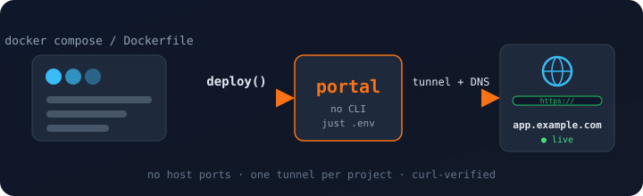
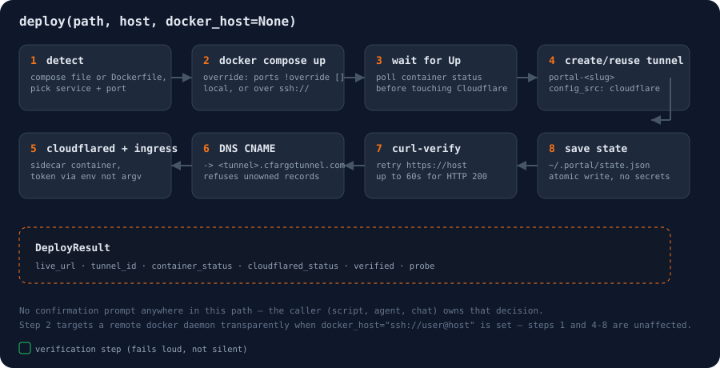

# portal

<p align="center"></p>

portal puts a dockerized project on a public hostname through Cloudflare
Tunnel. Give it a project directory and a hostname. It:

- builds and starts the project, publishing no host ports
- creates a tunnel just for that project and runs a `cloudflared` sidecar
- points DNS at the tunnel
- requests the hostname until something answers, then reports on the result

Each project gets its own tunnel and its own `cloudflared` container, so
tearing one down can't affect another.

## Quick start

```bash
python -m venv .venv && . .venv/bin/activate   # Windows: .venv\Scripts\activate
pip install -e .
cp .env.example .env                           # then add your Cloudflare token
```

```bash
python -m portal check --host app.example.com               # is the token good?
python -m portal -v deploy ~/code/myapp --host app.example.com
python -m portal verify myapp                               # health-check it later
python -m portal destroy myapp                              # remove everything
```

Requirements: Python 3.11+, the `docker` CLI on PATH with Compose 2.24 or newer,
and a Cloudflare API token.

## Configuration

portal reads one `.env` file:

```dotenv
CLOUDFLARE_API_TOKEN=...     # required
CLOUDFLARE_ACCOUNT_ID=...    # optional; looked up from the token if missing
```

The token needs three permissions:

- Account → Cloudflare Tunnel → Edit
- Zone → DNS → Edit
- Zone → Zone → Read

Real environment variables win over the file. portal finds the file by walking
up from the current directory. To use another file, set `PORTAL_ENV_FILE` or
pass `env_file=` to a call. `status()` and `inspect()` don't need the token.

Optional environment variables:

| Variable | Default | Effect |
| --- | --- | --- |
| `PORTAL_ENV_FILE` | nearest `.env` | Which file to read the token from |
| `PORTAL_HOME` | `~/.portal` | Where state and generated compose files live |
| `PORTAL_CLOUDFLARED_IMAGE` | a pinned `cloudflare/cloudflared` tag | Sidecar image to run |

### The project's own `.env`

This file belongs to portal. It is not the `.env` of the project you deploy.
portal never reads the values in that one. It passes the path to
`docker compose --env-file` and only compares key names against the project's
`.env.example`.

`deploy()` refuses to start if the project's `.env` doesn't cover its
`.env.example`, meaning a key is missing, or it's blank while the example gives
it a value. A blank value in the example marks the key as optional. To get a
warning instead, pass `strict_env=False` (CLI: `--allow-missing-env`).

## Python API

```python
from portal.api import check, deploy, destroy, status, inspect, verify

check("app.example.com").ok             # token active and able to deploy there?
inspect("~/code/myapp")                 # detected plan, no side effects

r = deploy("~/code/myapp", host="app.example.com")
r.live_url, r.verified, r.probe         # 'https://app.example.com', True, 'HTTP 200'
r.health.ok                             # env, containers, tunnel, ingress, DNS, HTTP

verify("myapp").ok                      # the same health checks, any time later
status()                                # every deployment: containers + a live probe
destroy("myapp")                        # DNS record, tunnel, containers, state entry
```

Things to know:

- **No confirmation prompts.** `deploy()` creates real Cloudflare resources and
  `destroy()` deletes them. If a human must approve that, the caller handles it.
- **Errors.** Failures raise `PortalError` with a message you can show as-is.
- **Hostname.** `host` must be bare, like `app.example.com`: no scheme, port,
  or path.
- **Naming.** A deployment's name (slug) comes from the directory name. Pass
  `name=` to change it. portal refuses to reuse a name for a different path.
- **Detection overrides.** `port=` and `service=` help when detection guesses
  wrong or the compose file has several candidate services.
- **Logging.** Progress goes to the `portal` logger. Call
  `logging.basicConfig(level=logging.INFO)` to watch a deploy step by step.
  Warnings show up without it.

## Command line

The CLI is a thin wrapper over the same calls.

| Command | Does | Options |
| --- | --- | --- |
| `check` | Test the token, read-only | `--host` |
| `inspect PATH` | Show the detected plan | `--port` `--service` `--name` |
| `deploy PATH` | Deploy | `--host` (required) `--port` `--service` `--name` `--docker-host` `--allow-missing-env` |
| `verify SLUG` | Run the health checks | `--no-probe` |
| `status [SLUG]` | List deployments with a live probe | `--no-probe` |
| `destroy SLUG` | Tear down | `--volumes` `--docker-host` |

Add `-v` before the command to see progress. `check`, `verify` and `deploy` exit
with status 1 when a check fails. `destroy` does too when cleanup is partial.

## Checking the token

`check()` tests the Cloudflare token without creating anything:

```text
$ python -m portal check --host app.example.com
ok    token       active account token, expires 2027-01-31
ok    tunnels     can list tunnels
ok    zone        example.com covers app.example.com
ok    dns         can read DNS records in example.com
```

It confirms the token is active (not expired, disabled, or revoked) and warns
when it expires within a week. It handles both user tokens and account-owned
tokens, then makes one cheap read call per permission portal needs. `deploy()`
runs the same checks before starting any containers, so a bad token fails in
seconds instead of after a full build.

**Limit:** a token can't read its own permissions, and Cloudflare can't tell
Read from Edit access without a write. A Read-only token passes `check()` and
then fails at the first write during `deploy()`.

## Health checks

`deploy()` finishes by running the health checks and returns them as
`result.health`. `verify(slug)` runs the same checks on an existing deployment.
Neither raises when a check fails. The report names the broken piece, and the
deployment stays in place so you can fix it or `destroy()` it.

```text
$ python -m portal verify myapp
ok    env         .env covers .env.example
ok    app         Up 2 minutes
ok    cloudflared Up 2 minutes
ok    tunnel      healthy, 4 connections
ok    ingress     app.example.com -> http://portal-myapp-app:8080
ok    dns         app.example.com -> <tunnel-id>.cfargotunnel.com (proxied)
ok    http        HTTP 200
```

| Check | Passes when |
| --- | --- |
| `env` | The project's `.env` covers its `.env.example` |
| `app` | The app container is `Up` |
| `cloudflared` | The sidecar is `Up` |
| `tunnel` | Cloudflare reports it healthy or degraded, with at least one connection |
| `ingress` | The tunnel has a rule for the host pointing at the app, plus the catch-all |
| `dns` | The CNAME points at the tunnel and is proxied |
| `http` | The hostname answers, and not with a Cloudflare edge error |

A container that isn't running is shown with its last few log lines. Because
the tunnel check asks Cloudflare directly, a crashed `cloudflared` shows up as
its own failure instead of only a failed HTTP request.

`verify` needs the Cloudflare token for the tunnel, ingress, and DNS checks.
Without one it runs the local checks and reports that the rest were skipped.

<p align="center"></p>

## What deploy() does

1. **Detect.** Finds the compose file, or a bare Dockerfile, and picks the
   service to expose. A service using `network_mode` is rejected, because
   compose can't attach it to portal's network. Missing or blank `.env` keys
   stop the deploy here.
2. **Check credentials.** Runs the same read-only checks as `check()`. Nothing
   has been started or created yet, so a failure here costs nothing.
3. **Start the app.** Runs `docker compose -p portal-<slug> -f <yours> -f
   <override> up -d --build`. portal never edits your compose file. The
   override sets a fixed `container_name`, joins the service to a per-project
   network (keeping its existing ones), adds `portal.*` labels, and sets
   `ports: !override []`.
   - The `!override` tag is needed because compose merges lists, so a plain
     `ports: []` would keep your port mappings. It requires Compose 2.24+.
   - A project with only a Dockerfile gets a minimal compose file generated
     under `~/.portal/projects/<slug>/`, not in your project.
4. **Wait for the container.** `compose up -d` returns once the container is
   created, even if it crashes a second later. portal waits up to 30 seconds
   for `docker ps` to show `Up` and raises otherwise. No Cloudflare resources
   exist before this point.
5. **Create the tunnel.** Creates `portal-<slug>`, or reuses it. It uses
   `config_src: cloudflare`, so ingress is managed through the API rather than
   a local config file.
6. **Start the sidecar.** Runs a pinned `cloudflare/cloudflared` image as
   `portal-<slug>-cloudflared` on the same network. The tunnel token is passed
   through the environment, so it never appears in the `docker run` arguments.
7. **Set ingress.** One rule for the hostname, then the required
   `http_status:404` catch-all.
8. **Point DNS.** Finds the zone by trying the hostname and then each parent
   domain, longest first, so a zone apex works. Creates or updates a proxied
   CNAME to `<tunnel-id>.cfargotunnel.com`, commented `managed by
   portal:<slug>`.
   - If a record for that name exists without this exact comment, portal
     refuses to change it. `destroy()` follows the same rule.
   - Redeploying under a new hostname deletes the old record.
9. **Verify.** Requests `https://<host>` every 3 seconds for up to a minute,
   since a new tunnel and DNS record often take a few seconds to route.
   Any app response counts, error statuses included. Cloudflare's own edge
   errors (502, 504, 520–530) don't, and portal keeps polling. If time runs
   out, `deploy()` still returns normally with `verified=False`, and `probe`
   holds the last status.
10. **Health report.** Runs the [health checks](#health-checks) and attaches
    them as `result.health`.

State is written to `~/.portal/state.json` as each resource is created, not
only at the end, so a deploy that fails halfway can still be cleaned up with
`destroy()`. The file holds IDs and paths, never secrets.

### destroy()

`destroy()` runs the steps in reverse. It stops the sidecar before deleting the
tunnel, because Cloudflare won't delete a tunnel with live connections. If
deleting the DNS record or tunnel fails, it logs a warning and still removes
the containers. It keeps the state entry (`state_removed=False`), so calling
`destroy()` again finishes the job.

## Remote hosts over SSH

The docker CLI can run against another machine's daemon with
`DOCKER_HOST=ssh://user@host`. portal exposes this as `docker_host=`:

```python
deploy(
    "~/code/myapp",
    host="app.example.com",
    docker_host="ssh://deploy@203.0.113.9",
)
```

The remote machine needs only `docker` and `sshd`. portal isn't installed
there. Your project stays local, and `docker compose build` sends the build
context over SSH.

Requirements:

- `ssh` on your local PATH
- **key-based** SSH access to the remote account
- Docker running remotely, with that user in the `docker` group

Pass `docker_host` only to `deploy()`. It's saved in `state.json`, and
`status()` and `destroy()` read it from there, so local and remote deployments
mix freely. Pass it to `destroy()` explicitly only to override the saved value.

### Password-only SSH won't work

docker runs `ssh` as a subprocess with no terminal, so a password prompt can't
be answered. The deploy hangs or fails. Set up a key first:

```bash
# dedicated keypair (or reuse one you already have)
ssh-keygen -t ed25519 -f ~/.ssh/portal_deploy -C "portal-deploy"

# install it; this is the last time you'll type the password
ssh-copy-id -i ~/.ssh/portal_deploy.pub deploy@203.0.113.9

# no ssh-copy-id (plain Windows)? From PowerShell:
type $env:USERPROFILE\.ssh\portal_deploy.pub | ssh deploy@203.0.113.9 "mkdir -p ~/.ssh && cat >> ~/.ssh/authorized_keys"

# should print "ok" without asking for anything
ssh -i ~/.ssh/portal_deploy deploy@203.0.113.9 echo ok
```

Then add the host to `~/.ssh/config` so plain `ssh://deploy@203.0.113.9` finds
the key:

```
Host 203.0.113.9
    User deploy
    IdentityFile ~/.ssh/portal_deploy
```

If you can't add a key to the remote account, `docker_host` won't work for
that machine. Run portal on the remote machine instead and leave it out.

## Scope

portal deploys one project per call. It has no drift detection, no automatic
rollback, no background daemon, and no shared tunnels. A failed deploy isn't
undone, but it's recorded, so `destroy()` can clean it up. `status()` and
`verify()` only report and never fix anything.

portal doesn't write Dockerfiles. The project needs a Dockerfile or compose
file already. Containerizing a project is a separate problem, and leaving it out
keeps portal small.

## Tests

```bash
pip install -e ".[dev]"
pytest
```

The suite covers project detection, the health checks, ingress building, the
state store and its lock, compose overrides, token checks, zone lookup and DNS
ownership, `docker_host` handling, `.env` loading, and full
`deploy()`/`status()`/`destroy()` runs. Those runs include half-finished
deploys, redeploys to a new hostname, name collisions, and partial teardowns.
Docker and Cloudflare are stubbed out, so `pytest` needs no daemon and no
credentials.

### Live Cloudflare test

To check a token against the real API, run:

```bash
PORTAL_RUN_LIVE_TESTS=1 pytest -m live -s -v tests/test_live_cloudflare.py
```

It creates a throwaway tunnel, confirms it, deletes it, and confirms it's gone.
It's opt-in and double-gated: a plain `pytest` excludes it, and it still skips
without the env var even with `-m live`. Two more switches widen it:

- `PORTAL_LIVE_TEST_ZONE=example.com` also checks zone visibility.
- `PORTAL_LIVE_TEST_DNS=1` (on top of the zone) creates and deletes a real
  CNAME. That briefly publishes a DNS record, so it's a separate opt-in.
